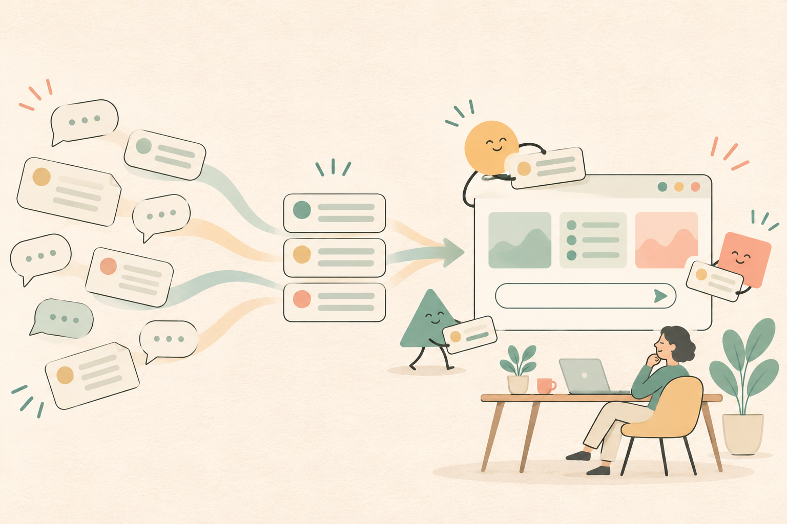
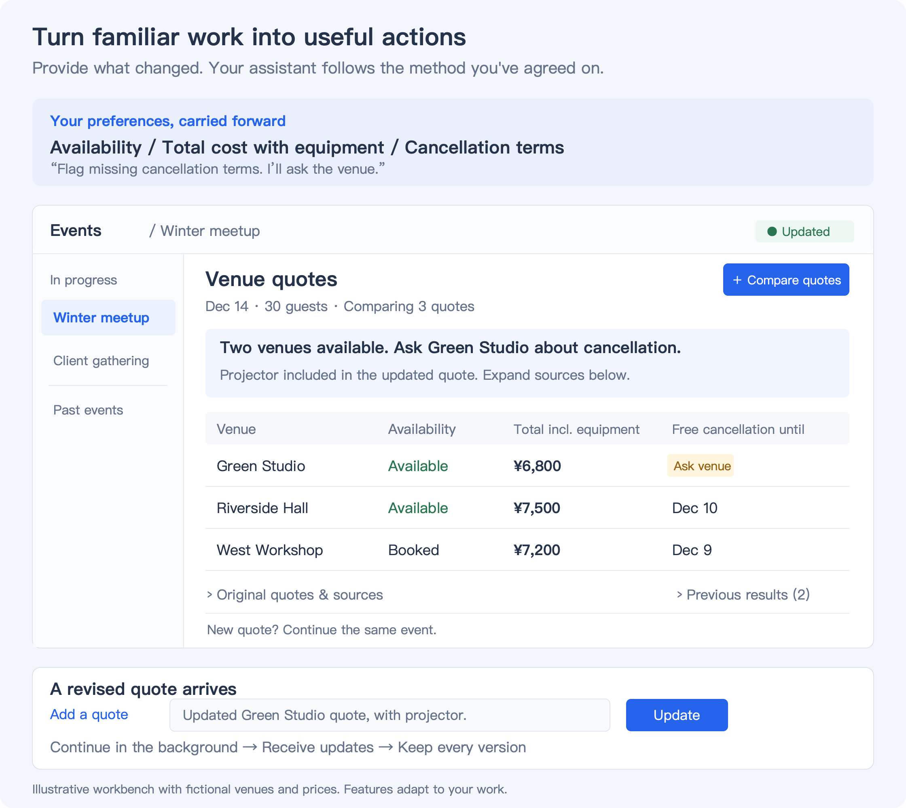

<h1 align="center">Personal Agent Workbench</h1>

<p align="center">A personal workbench shaped by the work you already do.</p>

<p align="center"><a href="README.md">简体中文</a> · <strong>English</strong></p>

<p align="center"><a href="#-get-started">Get started</a> · <a href="#-see-it-in-action">See it in action</a> · <a href="#-common-questions">Common questions</a> · <a href="LICENSE">MIT License</a></p>

<br>

You work with agents like Codex and Claude, and conversations pile up. You repeat the same context, lose track of last week's results, and struggle to see what still needs doing.

**Personal Agent Workbench** helps your own agent review the conversations you authorize, understand your everyday work and recurring methods, and build a personal workbench with you that opens in a browser on your computer.

Familiar work becomes a convenient action. Choose an item, provide what's changed, and let your agent continue—with progress and results back in the same place.

<br>



<br>

## ✨ Get started

**Send this prompt to your AI assistant.** Let it handle installation and local setup.

```text
Please install $personal-agent-workbench from this repository:
https://github.com/superNos/personal-agent-workbench-skill

First ask which conversation history you may read, then identify
my everyday work and reusable workflows. Help me choose one recurring
task and build a local workbench where I can assign work directly
and receive progress and results automatically.
```

You can start with a small scope:

> Only review my event-planning conversations from the past month. Skip private chats. First, tell me which tasks you think I keep repeating.

Your assistant checks its understanding and the proposed layout with you, then builds, connects, and verifies one real task. You don't need to design the interface or write a requirements document first.

<br>

## 🗓️ See it in action

Suppose you often compare venue quotes. Your assistant turns **availability, total cost including equipment, and cancellation deadlines** into a reusable action. It also carries forward a preference you confirmed: “Flag missing cancellation terms. I'll ask the venue.”

New quotes? Compare them. A revised quote? Continue the same event.



Everyone's workbench can be different. If you often revise drafts, your flow might be “Open a document → Choose a version → Leave feedback.” Its features come from how you actually work.

<br>

## 🧭 How it understands your work

### 1. Find the work across authorized history

Review all accessible conversations within the agreed scope and connect those that serve the same goal. Casual questions don't automatically become tasks. Completed items leave the active view, with results retained as authorized.

### 2. Turn recurring methods into useful actions

A method becomes a reusable action when it appears across separate work items, or when you explicitly say you'll use it again. Stable context, steps, and output requirements become part of the feature. You provide what changes this time.

### 3. Continue the work from your workbench

Once connected, actions run in the background in the appropriate project and conversation. Progress and conclusions return to the corresponding execution record. Established work stays in its original conversation; separate conversations can run in parallel, while work in the same conversation is queued.

<br>

## 🔐 You set the boundaries

- **What it reads.** Choose sources, dates, and exclusions. You can also provide just a few work samples.
- **What it saves.** Findings stay in the current conversation by default. Saving requires permission and a designated local folder. Personal workbenches and real records stay out of the public skill repository.
- **What it does externally.** Sending, submitting, publishing, paying, or deleting requires explicit authorization for that action. Past habits aren't permission.

A local workbench does not change how your AI provider handles data. Read the [privacy and security notes](SECURITY.md) (Chinese).

<br>

## 💬 Common questions

<details>
<summary><strong>Can I use this without being a developer?</strong></summary>

Yes. You decide which conversations are available, whether the assistant understands your work, and whether the interface feels useful. Your agent handles implementation and setup. Your environment must allow it to read and write local files and run a local workbench.

</details>

<details>
<summary><strong>Does it support Codex, Claude, and WorkBuddy?</strong></summary>

The maintainer has tried it in Codex. The same work-analysis approach can be used in Claude, WorkBuddy, and other environments, but history access, background execution, and result updates depend on the host's capabilities. Your assistant checks those connections first. Unconnected actions explain what's missing instead of pretending work has started.

</details>

<details>
<summary><strong>What if history is unavailable, or I don't want to share it all?</strong></summary>

Limit access to a project, date range, or set of conversations. Alternatively, provide work samples or describe how you usually handle a task. Your assistant identifies its sources and gaps; it doesn't treat inaccessible history as reviewed.

</details>

<details>
<summary><strong>Does everyone get the same workbench?</strong></summary>

No. There is no required set of task cards, boards, or charts. Occasional work may need only a way to start a task and retrieve results. Stable workflows can become dedicated features later.

</details>

<br>

## Documentation and contributions

[Skill instructions](skills/personal-agent-workbench/SKILL.md) · [Contributing](CONTRIBUTING.md) · [Changelog](CHANGELOG.md) · [Report an issue](https://github.com/superNos/personal-agent-workbench-skill/issues)

The linked supporting documents are currently in Chinese. Examples use fictional data. Please keep real conversations, personal information, and credentials out of public issues. Follow the [security notes](SECURITY.md) to report vulnerabilities privately.

[MIT License](LICENSE)
