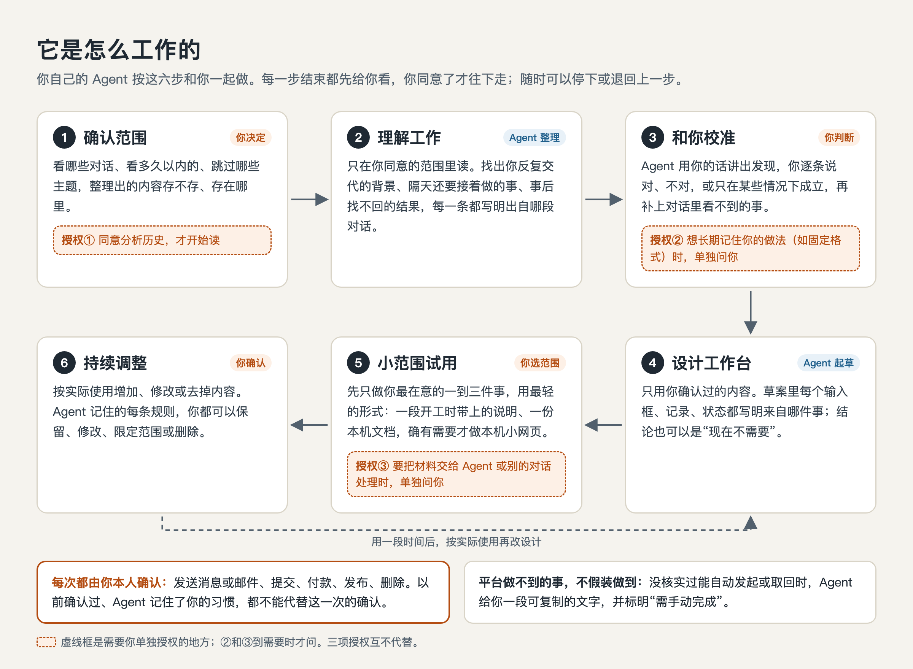
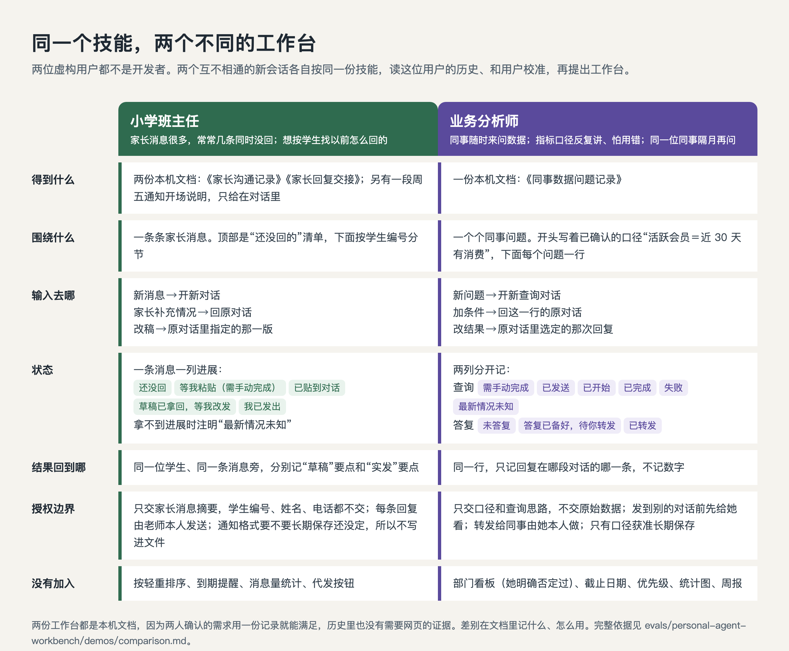
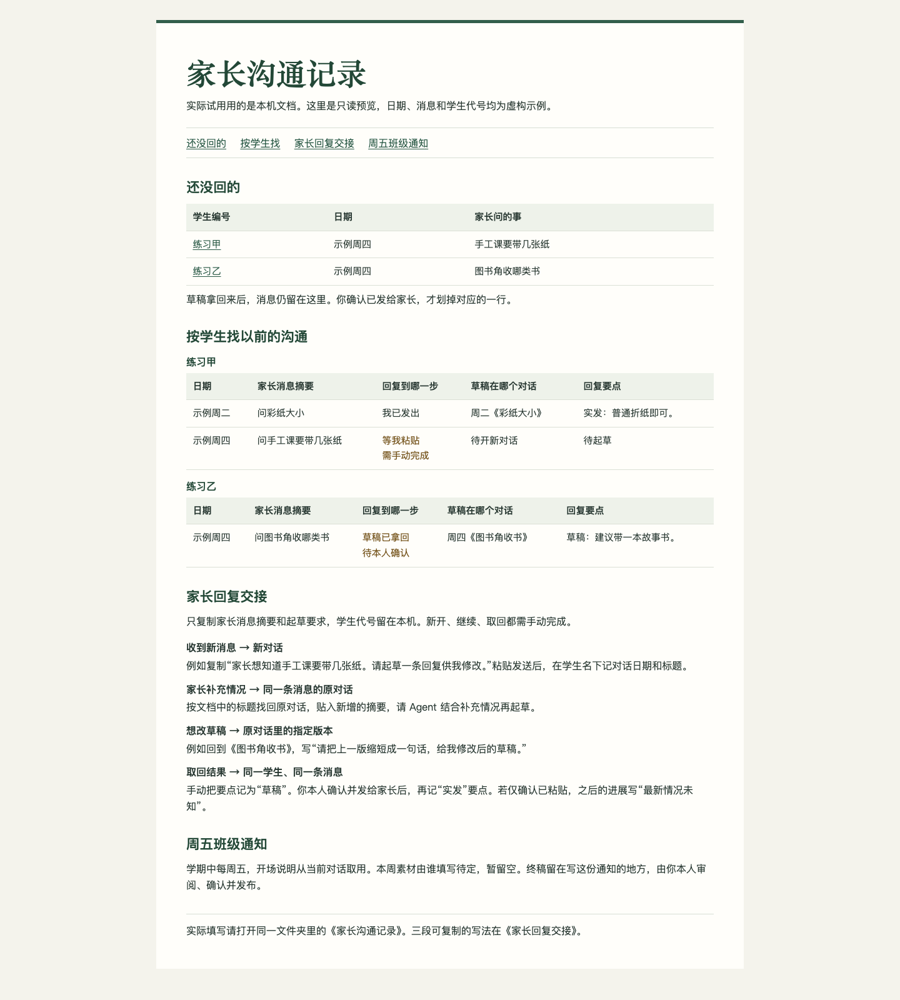

# 个人 Agent 工作台

*A Codex skill that lets your own AI agent study how you work (only what you allow) and build a personal workbench with you, instead of handing everyone the same template.*

你用 Codex、Claude 这类 Agent 做事，对话越积越多：同样的背景每次都要重讲，上周的结果找不到，哪些事还没做完也说不清。

这个技能让**你自己的 Agent** 先在你允许的范围里看看你过去的对话，弄清你平时到底在做什么，再和你一起决定：要不要一个工作台，要的话里面放什么。以后你可以在工作台里交代新的事、接着做没做完的事、找回以前的结果。

它**不做**这些事：

- 不给所有人发同一套模板。没有默认的任务卡、看板、周报或统计图，只放你的工作里确实需要的东西。结论也可能是“你现在不需要工作台”。
- 不偷偷读你的全部历史。看哪些对话、看多久以内的、存不存，都由你先决定。
- 不替你发送、提交、付款或删除。这些动作每一次都由你本人确认。


<sub>主视觉图由 AI 图像生成工具制作，只是示意，不代表你会得到这样的页面。</sub>

## 它是怎么工作的



整个过程分几轮对话完成，不会一上来就做东西。每一步结束，Agent 都先把结果给你看，你同意了才往下走。

“工作台”不一定是软件。它可能是一段每次开工时带上的说明，可能是一份放在你电脑上的记录文档，确有需要才是一个在你电脑上打开的小网页。

## 同一个技能，两个人得到的工作台不一样

我们请两个互不相通的新 Agent 会话，各自只读这个技能和一位虚构用户的对话记录，从头走了一遍。两位都不是开发者：一位是小学班主任，一位是零售业务分析师。



| 班主任的工作台预览 | 业务分析师的工作台预览 |
| --- | --- |
|  |  |

两份工作台都是本机文档：两人确认的需求，一份记录就能满足，历史里也没有需要网页的证据。截图是为了方便查看而做的静态预览，里面的行是虚构示例。

这两个结果只是评估演示，**不是模板**，不要照着搭。你的 Agent 会按你自己的对话重新推导。每个元素对应哪段对话、Agent 问了什么、放弃了哪些看似合理的功能，见 [演示说明](evals/personal-agent-workbench/demos/README.md) 和 [差异对比](evals/personal-agent-workbench/demos/comparison.md)。

## 三分钟上手

**1. 安装到 Codex。** 下载本仓库后，在仓库目录里运行：

```bash
python3 scripts/install.py          # 先预览会复制哪些文件，不写入任何东西
python3 scripts/install.py --apply  # 确认后再复制
```

脚本把 `skills/personal-agent-workbench/` 复制到 `${CODEX_HOME:-$HOME/.codex}/skills/`。如果那里已经有同名目录，脚本会停下，不覆盖也不删除。

不想运行脚本时，也可以用文件管理器把 `skills/personal-agent-workbench` 这个文件夹复制到上面的目录里。复制前先看一眼那里有没有同名文件夹；有的话，先决定旧的要不要保留，再动手，以免覆盖。

**2. 开一个新对话，把这句话发给 Agent：**

```text
使用 $personal-agent-workbench。我平时用 Agent 处理很多零散的工作，想看看能不能整理得更顺手。先告诉我你需要我授权什么。
```

Agent 会先说明它要看什么、存在哪里、不会做什么，再请你选择范围。拿不准时可以说“先看最近 4 周，只在这次对话里给我看”。

**其他 Agent（Claude、WorkBuddy 等）：未验证。** 技能本身只是几份中文说明文件，你可以试着把 `SKILL.md` 和 `references/` 目录交给它当作工作说明。它能不能读到你的历史、能不能替你开新对话，这个仓库都没有验证过；技能会要求 Agent 在你的环境里逐项核实，核实不了就给你可复制的文字，由你手动完成。

## 隐私与授权

- **三件事分开问。** 读你的历史、长期记住你的做法、把材料交给别的 Agent 或对话处理，每一件都单独征得你同意，同意一件不等于同意其它。
- **看多少由你定。** 你决定看哪些对话、多长时间以内、跳过哪些主题。平台读不到历史时，Agent 会请你粘贴几段，或者直接问你。
- **只记概括，不记敏感内容。** 不保存密码、令牌、账号、证件、付款信息，以及别人的电话、住址、成绩、健康等个人信息；遇到时只记“这里有一类什么信息”，并提醒你。
- **默认只在你的电脑上。** 存不存、存在哪里、留多久由你决定，你说删就删，并告诉你删了什么。
- **对外的动作每次确认。** 发送消息或邮件、提交、付款、发布、删除，每次都由你本人确认；以前确认过、或者 Agent 记住了你的习惯，都不能代替这一次。
- **不夸大进度。** “已发送”“已开始”“已完成”“待确认”“失败”分开显示；没核实的就写“需手动完成”或“最新情况未知”。

更多说明见 [SECURITY.md](SECURITY.md)。

## 适合谁，不适合谁

适合：

- 经常用 Agent 处理同一类工作的人，不论是老师、店主、分析师、译者、招聘专员还是开发者；
- 每次开工都要重讲一遍背景，或者常常找不回以前结果的人；
- 手头总有几件事做到一半、需要隔天接着做的人。

不太适合：

- 只是偶尔问个问题、很少回头看旧对话的人。技能多半会告诉你“现在不需要工作台”，这也是正常结论；
- 想要一个装好就能用的现成软件的人。这里没有现成页面，工作台要在和 Agent 的几轮对话里一起定下来；
- 不愿意让 Agent 看任何过去对话、也不想描述自己工作的人。没有依据，Agent 做不出合用的东西。

## 常见问题

**会不会把我的对话传到别处？**
技能要求 Agent 只在你授权的范围内读，整理结果默认只放在你电脑上，不放进会公开或同步给别人的位置。Agent 本身运行在哪里、平台怎样处理对话，取决于你用的 Agent 平台，不由这个技能决定。

**我不懂技术，能用吗？**
能。用户不熟悉技术时，技能要求 Agent 全程用日常说法，不用“字段”“接口”“页面结构”这类词。你只需要回答“这条对不对”“先做哪件事”这样的问题。

**最后一定会有个网页吗？**
不一定。技能要求选能解决问题的最轻做法。上面两个演示得到的都是文档，没有网页。

**Agent 记住的规则不对怎么办？**
告诉它。每条规则你都可以保留、修改、限定只在某些情况下用，或者删除。

**可以让它直接帮我发消息吗？**
技能不会让 Agent 自己决定发送。即使平台能做到，每一次发送也要你本人确认这一次。

**它和别的任务管理工具有什么区别？**
任务管理工具先定好格式，让你往里填。这个技能先看你实际怎么工作，再决定要不要格式、要什么格式。

## 给开发者

仓库结构：

| 路径 | 内容 |
| --- | --- |
| `skills/personal-agent-workbench/` | 技能本体：`SKILL.md`、`agents/openai.yaml`、`references/`（历史分析、校准访谈、工作台设计、交互约定、平台适配、质量检查、调整、虚构案例）。不含页面模板或运行脚本 |
| `evals/personal-agent-workbench/` | 评估材料：5 组虚构用户历史、[检查方法](evals/personal-agent-workbench/checks.md)、两个前向演示。含期望结论，不随技能安装，也不要交给被评估的 Agent |
| `openspec/changes/design-personal-agent-workbench/` | 本技能的 OpenSpec 变更：提案、设计、4 个能力的规格、任务 |
| `tests/` | 结构测试，以及发布检查和安装脚本的行为测试 |
| `scripts/check_skill.py` | 检查技能入口、调用名和参考文件路由 |
| `scripts/release_check.py` | 发布前安全检查：令牌、联系方式、本机路径、UUID、私有名称、图片元数据、隐藏与缓存文件、内部链接 |
| `scripts/install.py` | 安装脚本，默认只预览 |
| `docs/diagrams/` | README 流程图和对比图的 HTML 源文件 |
| `docs/images/` | README 用到的图片 |

验证（只需 Python 3.9 及以上，无第三方依赖）：

```bash
PYTHONDONTWRITEBYTECODE=1 python3 -m unittest discover -s tests -v
python3 scripts/check_skill.py
python3 scripts/release_check.py
openspec validate design-personal-agent-workbench --strict   # 需要另装 OpenSpec 命令行工具
```

`PYTHONDONTWRITEBYTECODE=1` 让测试不生成 `__pycache__`，否则发布检查会把它报出来。维护者若要检查真实组织或项目名称，把名称写进仓库以外的文本文件（每行一个），用环境变量 `WORKBENCH_PRIVATE_BLOCKLIST` 指向它再运行发布检查；清单本身不要提交。

自动检查只覆盖结构和公开安全，不能证明 Agent 的产出质量。产出质量按 [评估材料](evals/personal-agent-workbench/README.md) 的方法，由人或独立复核者判断。

贡献方式见 [CONTRIBUTING.md](CONTRIBUTING.md)，版本记录见 [CHANGELOG.md](CHANGELOG.md)。

## 许可证与致谢

[MIT](LICENSE)，Copyright (c) 2026 superNos。

主视觉图由 AI 图像生成工具制作。流程图和对比图由 HTML 绘制后截图，源文件在 `docs/diagrams/`。演示截图来自两个演示各自的静态预览。所有人物、学校、单位和对话都是虚构的。
