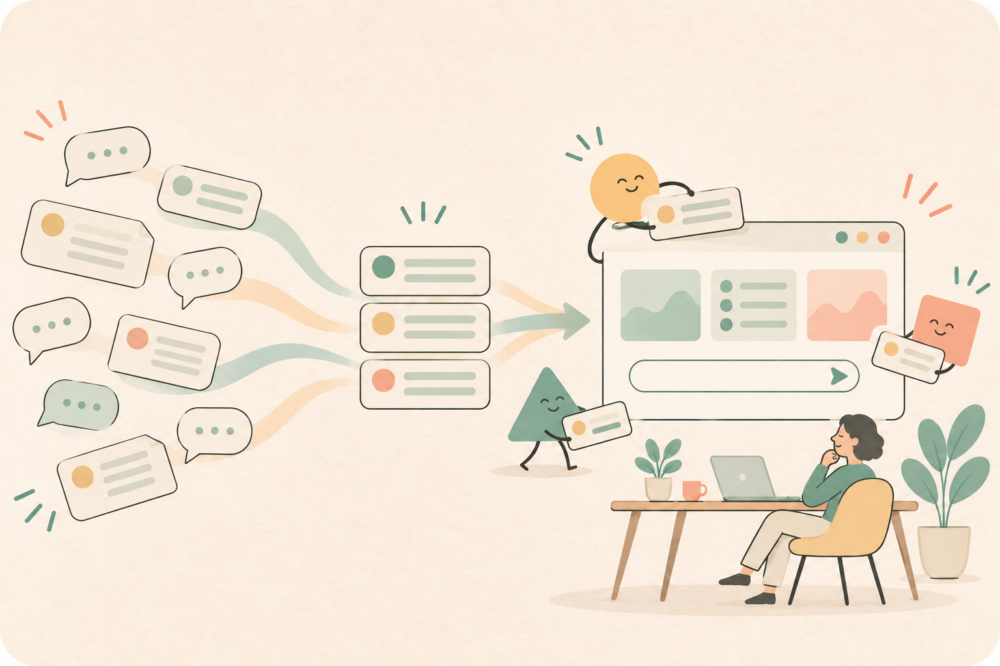

<p align="right"><strong>简体中文</strong> &nbsp; / &nbsp; <a href="README.en.md">English</a></p>

<p align="center">
  <picture>
    <source media="(prefers-color-scheme: dark)" srcset="docs/images/wordmark-dark.svg">
    
  </picture>
</p>

<p align="center">从对话到工作台，把日常做法变成顺手的操作。</p>

<p align="center"><a href="#-开始使用"><strong>开始使用</strong></a> &nbsp; · &nbsp; <a href="#-工作方式">工作方式</a> &nbsp; · &nbsp; <a href="#-看看效果">看看效果</a></p>

<br>

<p align="center">
  
</p>

<br>

你用 Codex、Claude 这类 Agent 做事，对话越积越多：同样的背景每次都要重讲，上周的结果找不到，哪些事还没做完也说不清。

**Chat to Desk** 让你自己的 Agent 阅读授权范围内的历史对话，整理日常工作和反复使用的做法，再在一个负责统筹工作的**总对话里打开专属面板**。你留在这个总对话中，由它协调整个工作流程。

面板把常做的事变成顺手的功能。选中事项、交代本次变化，就能让对应的 Agent 继续处理，进度与结果自动回到面板；调整工作安排时，可以直接和总对话沟通。


<br>

## 🧭 工作方式

**一个总对话负责统筹，一个面板承载日常操作，相关执行对话负责具体工作。** 工作台是你在总对话中协调工作的入口，不是生成后就与对话分离的独立应用。

| 在哪里 | 做什么 |
| --- | --- |
| **总对话** | 理解你的工作、整理流程、协调执行；你在这里补充要求、调整安排。 |
| **工作面板** | 在总对话中打开。按实际事项展示常用操作、当前进度、最新结论和下一步。 |
| **执行对话** | 在对应项目里处理具体工作。一直在某个对话办理的事，继续复用那个对话。 |

你在面板里发起操作，相关对话在后台执行，进度和结果回到同一事项。你可以继续留在总对话，不必逐个切换对话或复制粘贴任务。

<br>

## ✨ 开始使用

**把下面这段话发到你准备用来统筹工作的对话。** 安装和面板配置交给 Agent 处理。

```text
请帮我安装这个仓库里的 $chat-to-desk：
https://github.com/superNos/personal-agent-workbench-skill

先问我可以读取哪些历史对话，再整理我的日常工作和可复用流程。
把当前对话作为总对话，在这里打开我的工作面板，协调整个工作流程。
先和我选一件常做的事，在面板里提供对应操作，
接到合适的项目和执行对话，并自动把进度、结果带回这件事。
```

已安装旧版 `$personal-agent-workbench` 时，请让 Agent 将旧技能替换为 `$chat-to-desk`，保留个人工作台及数据。仓库地址不变。

第一次可以从一个小范围开始：

> 只看最近一个月我筹备活动的对话，私人聊天跳过。先告诉我，你觉得哪些事我总在重复做？

总对话中的 Agent 会先和你确认对工作的理解及面板草案，再打开面板、接通执行对话并验证一项实际工作。无需提前设计页面或整理需求文档。

<br>

## 🗓️ 看看效果

假设你经常比较场地报价。助手把你关心的**档期、含设备总价和取消期限**整理成一个常用功能，也记住你确认过的习惯：“没写取消期限的单独标出来，我来问。”

下次收到报价，直接比较；收到补价，继续同一场活动。


每个人的工作台都可以不同。如果你经常改稿，入口可能是「打开稿件 → 选中一版 → 留下修改意见」。页面里的功能来自你实际做事的方法。

<br>

## 🧭 它怎样理解你的工作

### 1. 从授权历史中找到事情

整理范围内全部可访问的对话，把围绕同一目标的工作连起来。零散问答不会自动变成待办；已经办完的事项退出当前列表，结果按授权保留。

### 2. 把反复使用的做法变成功能

同一方法在不同事情中复用，或你明确以后还会用，才提炼成常用操作。固定背景、步骤和结果要求融入功能，你只需填写这次变化的信息。

### 3. 由总对话协调，在面板里办理

总对话负责把事项、流程和执行对话组织起来。面板接通后，操作在后台交给对应项目和对话，进度与结论自动回到这次记录。固定在原对话处理的事继续复用原对话；不同对话可并行，同一对话按顺序排队。

<br>

## 🔐 由你决定的边界

- **读取范围。** 你决定来源、时间和排除项；也可以只提供几个工作样例。
- **保存内容。** 分析发现默认只在当前对话展示；得到许可后才保存到指定的本机目录。个人工作台与真实记录不进入公开 skill 仓库。
- **对外行动。** 发送、提交、发布、付款或删除需要针对这次操作的明确授权，不从历史习惯推断许可。

本机工作台不改变你所用 AI 平台的数据处理方式。详见[隐私与安全说明](SECURITY.md)。

<br>

## 💬 常见问题

<details>
<summary><strong>我不是开发者，可以用吗？</strong></summary>

可以。你负责说明哪些对话能看、助手是否理解了你的工作，以及页面是否顺手；搭建和配置由 Agent 处理。使用环境需要支持在对话中打开面板，并允许 Agent 读写本机文件、运行面板所需的本机服务。

</details>

<details>
<summary><strong>支持 Codex、Claude 和 WorkBuddy 吗？</strong></summary>

维护者在 Codex 上试通过。Claude、WorkBuddy 等环境可以使用同一套工作分析方法，但对话内面板、历史访问、后台发送和结果回传取决于宿主提供的能力。助手会先核实连接条件；没有接通的操作会说明原因，不会显示成已经开始。

</details>

<details>
<summary><strong>助手读不到历史，或者我不想开放全部历史怎么办？</strong></summary>

可以限定项目、时间或一组对话，也可以提供工作样例、描述平时的处理方式。助手会说明分析依据和缺失部分，不会把无法访问的历史当成已读内容。

</details>

<details>
<summary><strong>所有人都会得到同一种工作台吗？</strong></summary>

不会。没有统一的任务卡、看板或统计图模板。工作零散时，可能只需要一个发起入口和一处找回结果的地方；方法稳定后，再把常用流程做成独立功能。

</details>

<br>

## 文档与贡献

[技能说明](skills/chat-to-desk/SKILL.md) · [参与贡献](CONTRIBUTING.md) · [版本记录](CHANGELOG.md) · [报告问题](https://github.com/superNos/personal-agent-workbench-skill/issues)

文档与演示仅使用虚构数据。请勿在公开 issue 中粘贴真实对话、个人资料或密钥；安全问题请按[安全说明](SECURITY.md)私下报告。

[MIT License](LICENSE)
