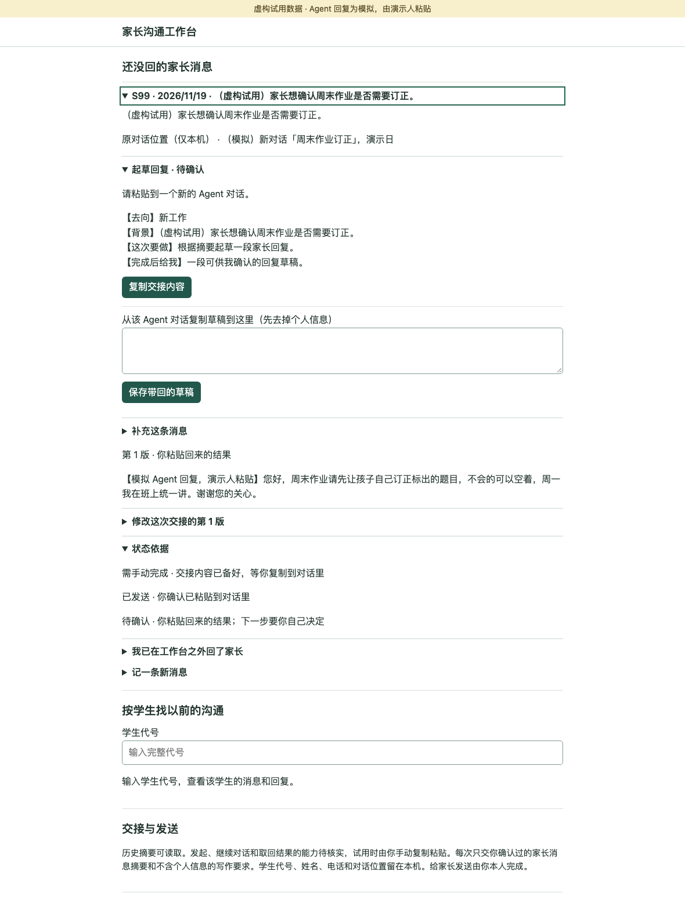
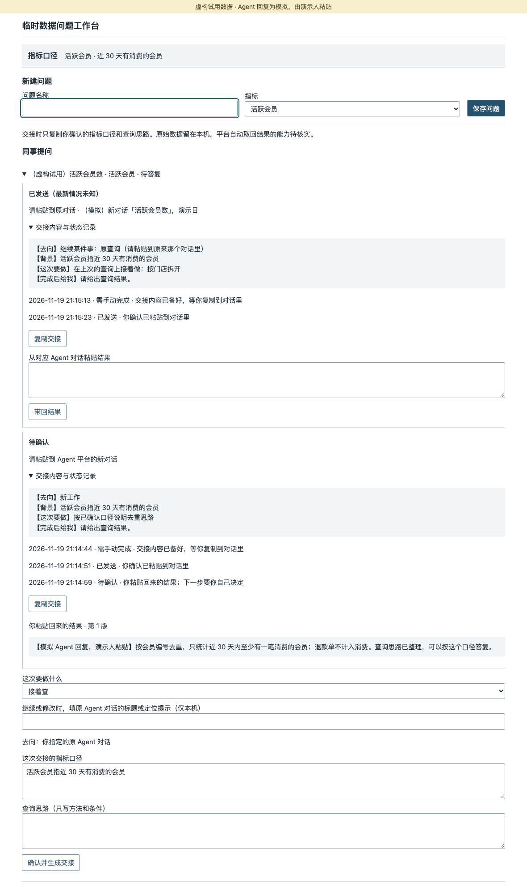

# 两个工作台的差异对比

两位用户都不是开发者，用的是同一份 `$personal-agent-workbench`，由两个互不相通的会话分别推导。两人得到的都是在浏览器里打开的本机工作台，由同一个与工作内容无关的运行支持提供服务；页面上有什么，是各自的 Agent 根据各自的历史和确认结果生成的。下表的引用都能在各自的 `agent-output/`、`trial-state.json` 和 `transcript.md` 中查到。

| E1 班主任：家长沟通工作台 | E3 业务分析师：临时数据问题工作台 |
| --- | --- |
|  |  |

## 五个方面

| 方面 | E1 班主任 | E3 业务分析师 |
| --- | --- | --- |
| 工作对象 | 一条家长消息：学生代号、日期、摘要。页面顶部是“还没回的家长消息”，老师确认已回之前一直留在这里；下面是“按学生找以前的沟通” | 一个同事提出的问题：问题名称、指标（下拉只有活跃会员、复购率）。页面顶部是已保存的指标口径“活跃会员 · 近 30 天有消费的会员”，下面是“同事提问”，每个问题标“待答复/已答复” |
| 对应证据 | W1（H1、H2、H4、H6 请 Agent 起草家长回复），老师补充“每周十几条，常常同时有好几条没回”；W2（H5、H8 翻旧对话找以前的沟通），老师确认“按学生找最麻烦” | W1（H1、H3、H6 三次重讲活跃会员口径），用户说“口径用错是最大的麻烦”并单独同意保存口径 R1；W3（H2、H7 同事隔段时间重复问），W5（用户自述同时有三四位同事的问题没答完）；试用范围限定为两个指标 |
| 输入方式 | “记一条新消息”：学生代号加摘要。每条消息下有“请 Agent 起草”“补充这条消息”和“修改这次交接的第 N 版”，各有“允许交给 Agent 的摘要”和“写作要求”两个输入框；输入像电话号码会被拦下 | “新建问题”：名称加指标。每个问题下有“这次要做什么”（新开查询 / 接着查 / 修改结果）、原对话定位提示、“这次交接的指标口径”（选活跃会员时预填 R1，复购率由用户自己填）和“查询思路（只写方法和条件）” |
| 对应证据 | 授权预设：交给 Agent 的只能是家长消息摘要，学生全名和家长电话不能交；起草、补充、改稿三种去向来自 W1、W2 和确认过的草案 | W2（H4、H8 两次把上次的结果粘回来接着查，其中一次加条件），用户确认“希望接着上次的查询继续”；授权预设：交给 Agent 的只能是指标口径和查询思路 |
| 操作与状态 | 起草：需手动完成 → 已粘贴后“已发送（最新情况未知）” → 粘贴回草稿后“待确认”。另有“Agent 明确报错了”才记失败。回复家长是单独一步：“我已在工作台之外回了家长”，确认后显示“已记录发给家长”，消息才离开“还没回的” | 每次交接：需手动完成 → 已发送（最新情况未知）→ 粘贴回结果后“待确认”。问题本身的“待答复/已答复”单独记：“标为已答复”要先确认“你已经亲自把这条答复转发给同事了吗？” |
| 对应证据 | H1“自己改后发出”、H2“我自己发，不要帮我发”、H6 本人发送：拿到草稿不等于回了家长；三项平台能力待核实 | H2、H7 两次都由本人转发；W5 要知道“哪些已经答复”，查询完成和答复转发是两件事；取回能力待核实，模拟平台没有调用接口 |
| 结果回写 | 草稿粘贴回同一条消息下，标“第 1 版 · 你粘贴回来的结果”，可以针对某一版再改；实际发给家长的话在老师确认后另记一笔；按学生代号能查到该学生的摘要、草稿和实际回复 | 结果粘贴回发起交接的那个问题下；“接着查”的交接写明“请粘贴到原来那个对话里”，并显示用户填的原对话定位；同一个问题下列出它的每次交接，最新的在上面 |
| 对应证据 | W2 要找的是“以前怎么回的”，所以草稿和实发分开记；试用记录 `trial-state.json` 里 h1 的事件依次是需手动完成、已发送、待确认 | W2 接着原查询继续；试用记录里 h2 的 `continues` 指向 h1，事件停在已发送，没有结果 |
| 授权边界 | 每次生成交接前弹出确认：摘要和写作要求里没有学生全名、家长电话、学生代号或其他个人信息；学生代号、原对话位置和实际回复只记在本机；给家长发送由老师本人完成 | 每次生成交接前弹出确认：只含指标口径和查询思路；原始数据留在本机；长期保存的只有口径 R1；转发给同事由本人完成 |
| 对应证据 | `authorization.handoff` 的预设回答；保存规则没有授权，R1–R3 待问 | `authorization.save_rules`、`excluded`、`handoff` 的预设回答；第 4 轮用户确认口径并同意本机保存 |

## 各自独有的元素

- 只有 E1 有：按学生代号查找、“还没回的”清单、电话号码拦截、“我已在工作台之外回了家长”。来源是老师的两件麻烦（同时有好几条没回、按学生找以前的沟通）和“只交摘要”的限制。
- 只有 E3 有：页面顶部的指标口径、指标下拉、“新开查询 / 接着查 / 修改结果”的选择、原对话定位输入、“待答复/已答复”。来源是她确认的最大麻烦（口径用错）、两次接着查的历史和“由本人转发”。

## 两个 Agent 都没有加入的元素

E1 的过程记录写明：周五通知进了草案，老师选定首版不试；个人出游（H10）与工作无关；没有自动发起、续接和取回，因为平台能力待核实；没有替老师给家长发送的按钮。E3 的过程记录写明：部门看板（H5）用户本轮明确不需要；“旧结果难找”的专门入口和预设续查去向，用户说不清，没有做；自动转发没有进入草案。两个页面都没有任务编号、开发状态、提交确认、看板、统计图或周报。

## 与场景期望的差别

| 场景 | 期望元素 | 演示结果 |
| --- | --- | --- |
| E1 | 粘贴家长消息、生成回复草稿的入口 | 有：“记一条新消息”和每条消息下的“请 Agent 起草” |
| E1 | 尚未回复的家长消息一览 | 有：“还没回的家长消息” |
| E1 | 按学生代号查以前的家长沟通 | 有：“按学生找以前的沟通” |
| E1 | 周五班级通知格式说明 | 暂缓：老师选定首版不试，保存授权待问 |
| E1 | 回复由老师本人确认并发送 | 有：“我已在工作台之外回了家长”，确认后才记 |
| E3 | 指标口径资料 | 有：页面顶部，选活跃会员时预填进交接 |
| E3 | 各位同事的问题答到哪一步 | 有：每个问题标“待答复/已答复” |
| E3 | 从某次查询结果继续的输入 | 有：“接着查”加原对话定位 |
| E3 | 答复发给同事前由本人确认 | 有：“标为已答复”前确认已亲自转发 |
| E3 | 按提问同事整理的答复记录 | 没有“同事”一栏，只能按问题名称找，见 [README.md](README.md) 的偏差说明 |
